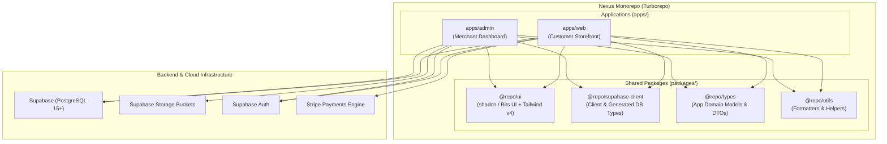
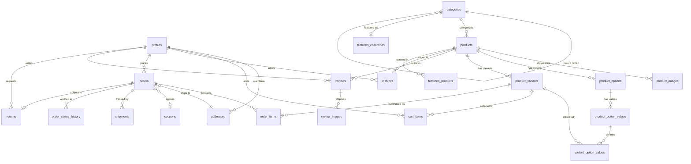

# Nexus — Modern Full-Stack E-Commerce Platform

[](LICENSE)
[](https://kit.svelte.dev/)
[](https://supabase.com/)
[](https://tailwindcss.com/)
[](https://turbo.build/)

> An enterprise-grade, high-performance full-stack e-commerce platform built with **SvelteKit 5**, **Supabase (PostgreSQL 15+ with RLS)**, **Tailwind CSS v4**, and **Stripe**, organized as a **Turborepo monorepo**.

---

## 📌 Project Overview

**Nexus** is an enterprise-grade, high-performance e-commerce platform dedicated to modern consumer electronics, computing gear, and smart lifestyle gadgets. Engineered using a **Turborepo monorepo architecture**, the platform decouples the customer-facing storefront from the merchant administrative back-office while sharing a unified design system, typed Supabase client, domain models, and helper utilities.

### 🎯 Platform Specifications

| Attribute | Details |
| :--- | :--- |
| **Architecture** | Turborepo Monorepo (Storefront + Merchant Admin Dashboard) |
| **Frontend Framework** | SvelteKit 5 (Svelte 5 Runes, SSR, Form Actions) |
| **Design System** | Tailwind CSS v4, Bits UI (shadcn-svelte architecture) |
| **Database & Auth** | Supabase (PostgreSQL 15+, Auth, Storage, Row Level Security) |
| **Payments Engine** | Stripe Elements & Payment Intents with Webhooks |
| **Type Safety** | End-to-end TypeScript with auto-generated Supabase schema types |
| **Package Manager** | npm workspaces |
| **License** | MIT |

---

## 🏗️ System Architecture

The project is structured as a **Turborepo monorepo** managed with `npm workspaces`. This architecture enforces clean separation of concerns, high code reuse, and independent deployment capabilities for the storefront and administration consoles.



### 📁 Repository Structure

```text
ecommerce-svelte-supabase/
├── apps/
│   ├── web/                    # Customer-facing storefront (SvelteKit 5 + SSR)
│   │   ├── src/routes/
│   │   │   ├── (store)/        # Public shopping catalog, product details, categories
│   │   │   ├── (auth)/         # Customer authentication (login, signup, callback)
│   │   │   ├── (account)/      # Authenticated user dashboard, orders, wishlist, addresses
│   │   │   ├── cart/           # Shopping cart management
│   │   │   ├── checkout/       # Checkout pipeline with Stripe integration
│   │   │   └── api/cart/       # Cart mutation REST endpoint
│   │   └── static/             # Storefront assets
│   └── admin/                  # Merchant management portal (SvelteKit 5 + RBAC)
│       └── src/routes/
│           ├── (auth)/         # Admin authentication with role validation
│           └── (dashboard)/    # Analytics, products, orders, returns, reviews, CMS, settings
├── packages/
│   ├── ui/                     # Shared UI component library (59+ components, Bits UI / Tailwind v4)
│   ├── supabase-client/        # Supabase client singleton & auto-generated schema types
│   ├── types/                  # Shared TypeScript interfaces, DTOs, and domain models
│   └── utils/                  # Currency formatting, slug generators, and shared helpers
├── supabase/
│   ├── migrations/             # SQL migrations (tables, RLS policies, triggers, RPC functions)
│   ├── seed.sql                # Seed dataset (categories, products, coupons, orders)
│   ├── mock_data.sql           # Extended mock dataset (variants, multi-currency, CMS banners)
│   └── config.toml             # Local Supabase environment configuration
├── turbo.json                  # Turborepo task pipeline configuration
└── package.json                # Root monorepo workspace dependencies and scripts
```

---

## 🚀 Key Features

### 🛍️ Customer Storefront (`apps/web`)

1. **Dynamic Curated Homepage:**
   - Active marketing hero banners with scheduled validity dates.
   - Featured category cards (Audio, Wearables, Computer Accessories, Gaming Gear, Home Office, Smart Home).
   - Automated product showcases: *Featured*, *New Arrivals*, *Best Sellers*, and *Trending*.

2. **Advanced Product Catalog & Filtering:**
   - Multi-parameter filtering by category, real-time price slider, keyword search, and sorting.
   - Clean URL query synchronization (`?category=`, `?search=`, `?sort=`, `?minPrice=`, `?maxPrice=`).
   - Responsive product grid with pagination.

3. **Product Detail & Variant Engine:**
   - Multi-axis variant matrix (e.g., Color, Size, Switch Type, Chassis Finish).
   - Dynamic variant-specific price, SKU, stock quantity, and imagery.
   - Flash-sale awareness via database function `effective_price()`.
   - Rich image gallery with interactive thumbnail selector.

4. **Multi-Currency Display System:**
   - Store operates in base currency (`INR`) while providing real-time display conversions to `USD`, `EUR`, `GBP`, and `JPY`.
   - Client and server-side currency switching with exchange-rate accuracy.

5. **Reviews & Social Proof:**
   - Customer review submission with 1–5 star ratings and photo uploads (`review-images` storage bucket).
   - **Automated Verified Purchase Badge:** PostgreSQL trigger validates past completed delivery before awarding the badge.

6. **Cart & Secure Checkout Flow:**
   - Server-validated cart calculations with coupon discount code redemptions.
   - Stock deduction via atomic Postgres RPC to prevent race conditions during high concurrency.
   - Saved delivery address picker or inline creation.
   - Stripe Payment Intent integration.

7. **Customer Account Portal:**
   - Profile management with avatar uploads (`avatars` storage bucket).
   - Address book management with default address assignment.
   - Order history with live milestone status tracker (`pending` → `paid` → `shipped` → `delivered`).
   - Integrated carrier shipment tracking (tracking number & carrier details).
   - Whole-order return request workflow with status updates.
   - Personal Wishlist system.

8. **Content & Static CMS Pages:**
   - Database-driven static pages (`/about`, `/faq`, `/terms`, `/contact`, `/shipping`).

---

### ⚙️ Merchant Admin Portal (`apps/admin`)

1. **Executive KPI Dashboard:**
   - Real-time revenue metrics, order velocity, inventory health, and recent customer activities.

2. **Catalog & Inventory Management:**
   - Create, edit, and archive products and categories.
   - Multi-option variant builder (create options like *Color*, *Size* and associate SKU, stock, and pricing).
   - Bulk image uploader (`product-images` bucket).
   - Flash sale scheduler (sale price with start and end timestamps).

3. **Order Fulfillment & Shipment Tracking:**
   - Manage order lifecycle transitions (`pending` → `paid` → `shipped` → `delivered` → `cancelled`).
   - Assign carriers and tracking numbers; create shipment records.
   - Automated immutable audit trail of all status transitions (`order_status_history`).

4. **Returns & Refunds Workflow:**
   - Review customer return requests with stated reasons.
   - Approve, reject, or mark as refunded with audit timestamps and Stripe refund integration.

5. **Review Moderation:**
   - Moderate customer reviews, inspect attached user images, and flag content.

6. **Promotional Content & CMS Management:**
   - Configure homepage hero banners (title, subtitle, imagery, links, scheduling).
   - Manage featured categories and curated product rails.
   - Rich static page editor for legal and informational pages.

7. **Store Settings & Exchange Rates:**
   - Set base store currency and manage international exchange rates.

8. **Role-Based Access Control (RBAC):**
   - Protected routes guarded by Supabase Auth and database-level `is_admin()` checks.

---

## 💾 Database Engineering & Relational Design

The backend is built on **Supabase (PostgreSQL 15+)** with a strictly typed relational schema, Row Level Security (RLS) policies on every table, database triggers, and stored procedures (RPCs).

### 📊 Entity Relationship Diagram



### 🛡️ Advanced Database Mechanisms

1. **Row Level Security (RLS):**
   - **Public Read:** Active products, categories, active banners, verified reviews, and published static pages are publicly readable.
   - **Owner-Only Isolation:** User profiles, addresses, carts, wishlists, and orders can only be accessed or modified by their respective authenticated owner (`auth.uid() = user_id`).
   - **Admin Elevation:** Write operations on catalog, banners, settings, orders, and returns are restricted to users with `role = 'admin'` via the database function `is_admin()`.

2. **Atomic Inventory Decrement (`decrement_stock` RPC):**
   - Stock deduction executes inside an atomic PostgreSQL function, guaranteeing inventory consistency and eliminating race conditions when multiple customers purchase the same variant simultaneously.

3. **Automated Order Status Audit Trigger (`trg_log_order_status`):**
   - Automatically writes an immutable audit record to `order_status_history` whenever an order is created or its status changes. Application code is prohibited from direct insertion.

4. **Automated Verified Purchase Badge Trigger (`trg_set_verified_purchase`):**
   - Runs `BEFORE INSERT` on the `reviews` table, verifying whether the reviewing customer has a completed delivery (`status = 'delivered'`) for the product before setting `is_verified_purchase = true`.

5. **Multi-Currency Conversion Function (`convert_price` RPC):**
   - Computes deterministic currency conversions against the `exchange_rates` table and rounds dynamically according to the target currency's decimal precision.

---

## 💻 Tech Stack & Tools

| Layer | Technologies |
| :--- | :--- |
| **Frontend Framework** | [SvelteKit 5](https://kit.svelte.dev/) (Svelte 5 Runes, SSR, Form Actions) |
| **Monorepo Engine** | [Turborepo](https://turbo.build/repo) (Remote Caching, Task Pipelines, npm Workspaces) |
| **Database & Auth** | [Supabase](https://supabase.com/) (PostgreSQL 15+, Supabase Auth, Row Level Security) |
| **Storage Engine** | Supabase Storage (`product-images`, `avatars`, `review-images`, `public-files`) |
| **Styling & Design System**| [Tailwind CSS v4](https://tailwindcss.com/), [Bits UI](https://bits-ui.com/) (shadcn-svelte architecture) |
| **Icons** | [Lucide Svelte](https://lucide.dev/) |
| **Payments** | [Stripe](https://stripe.com/) (Stripe.js & Stripe Node SDK) |
| **Validation** | [Zod 4](https://zod.dev/) (Schema validation for forms and API contracts) |
| **Language & Tooling** | TypeScript 7+, Vite 8+, ESLint, Prettier |

---

## 🛠️ Getting Started & Local Setup Guide

### 📋 Prerequisites

- **Node.js:** `>= 24.0.0`
- **npm:** `>= 12.0.0`
- **Supabase CLI:** (Optional for local PostgreSQL) or an active [Supabase Cloud](https://supabase.com) project
- **Git**

---

### 1️⃣ Clone the Repository

```bash
git clone https://github.com/MalavMori/ecommerce-svelte-supabase.git
cd ecommerce-svelte-supabase
```

### 2️⃣ Install Dependencies

Install all monorepo dependencies across apps and shared packages:

```bash
npm install
```

### 3️⃣ Configure Environment Variables

Create environment configuration files for both applications from their `.env.example` templates:

#### Storefront: `apps/web/.env`

```ini
PUBLIC_SUPABASE_URL=https://your-project.supabase.co
PUBLIC_SUPABASE_ANON_KEY=your-supabase-anon-key
SUPABASE_SERVICE_ROLE_KEY=your-supabase-service-role-key

PUBLIC_STRIPE_PUBLISHABLE_KEY=pk_test_your_stripe_publishable_key
STRIPE_SECRET_KEY=sk_test_your_stripe_secret_key
STRIPE_WEBHOOK_SECRET=whsec_your_stripe_webhook_secret
```

#### Admin Dashboard: `apps/admin/.env`

```ini
PUBLIC_SUPABASE_URL=https://your-project.supabase.co
PUBLIC_SUPABASE_ANON_KEY=your-supabase-anon-key
STRIPE_SECRET_KEY=sk_test_your_stripe_secret_key
```

---

### 4️⃣ Database Setup (Supabase)

#### Option A: Local Supabase CLI (Recommended)

1. Start local Supabase Docker containers:
   ```bash
   npm run db:start
   ```
2. Apply all migrations and populate the database with seed data:
   ```bash
   npm run db:reset
   ```
3. Generate TypeScript types directly from the database schema:
   ```bash
   npm run db:types
   ```

#### Option B: Remote Supabase Cloud

1. Link your remote Supabase project:
   ```bash
   npx supabase link --project-ref your-project-ref
   ```
2. Push migrations to the remote database:
   ```bash
   npm run db:push
   ```
3. Run `supabase/seed.sql` and `supabase/mock_data.sql` in the Supabase SQL Editor.
4. Regenerate types:
   ```bash
   npm run db:types
   ```

---

### 5️⃣ Granting Admin Privileges

To access the Admin Portal (`apps/admin`), an account must have the `admin` role in `profiles`:

1. Sign up a new user via the Storefront (`http://localhost:5173/signup`).
2. In your Supabase SQL Editor or psql console, elevate the user:
   ```sql
   UPDATE profiles
   SET role = 'admin'
   WHERE id = 'YOUR_USER_UUID';
   ```
3. You can now log into the Admin Portal at `http://localhost:5174/login`.

---

### 6️⃣ Run the Development Servers

Start all applications and packages concurrently with Turborepo:

```bash
npm run dev
```

| Application | URL | Description |
| :--- | :--- | :--- |
| **Storefront (`web`)** | `http://localhost:5173` | Customer shopping experience |
| **Admin Portal (`admin`)** | `http://localhost:5174` | Merchant management dashboard |

---

## 📜 Available NPM Scripts

All commands can be executed from the root directory:

| Script | Command | Purpose |
| :--- | :--- | :--- |
| `npm run dev` | `turbo run dev` | Runs both `web` and `admin` in concurrent development mode |
| `npm run build` | `turbo run build` | Compiles production builds for all apps and packages |
| `npm run check-types` | `turbo run check-types`| Performs static type-checking with `svelte-check` |
| `npm run lint` | `turbo run lint` | Runs ESLint checks across all workspaces |
| `npm run format` | `prettier --write ...` | Formats all code according to project style standards |
| `npm run db:start` | `supabase start` | Launches local Supabase Docker containers |
| `npm run db:stop` | `supabase stop` | Shuts down local Supabase containers |
| `npm run db:push` | `supabase db push` | Pushes pending schema migrations to database |
| `npm run db:reset` | `supabase db reset` | Resets local database and reapplies seeds |
| `npm run db:types` | `supabase gen types ...`| Regenerates `@repo/supabase-client` TypeScript types |

To target a specific application, use Turborepo's `--filter` flag:

```bash
# Develop only the storefront
npm run dev -- --filter=web

# Build only the admin portal
npm run build -- --filter=admin
```

---

## 💡 Key Architectural Principles

This project was built to demonstrate best practices in modern web development:

1. **Monorepo Architecture & Code Reusability:**
   Shared UI component libraries (`@repo/ui`), data contracts (`@repo/types`), and client abstractions (`@repo/supabase-client`) prevent code duplication across micro-frontends.

2. **Defense-in-Depth Database Security:**
   Rather than relying solely on application middleware, PostgreSQL **Row Level Security (RLS)** guarantees that unauthorized data access is prevented at the database engine level.

3. **Concurrency & Race Condition Mitigation:**
   Resolving inventory over-allocation during high-demand sales by implementing ACID-compliant stored procedures (`decrement_stock`) executed in single atomic database transactions.

4. **Event-Driven Database Triggers:**
   Offloading business integrity checks (e.g., verifying purchase history before approving reviews, immutable status logging) to database-level triggers to guarantee audit compliance.

5. **Modern Reactive UI with Svelte 5:**
   Leveraging fine-grained reactivity with Svelte 5 Runes (`$state`, `$derived`, `$props`) to achieve high runtime performance without virtual DOM overhead.

---

## 📄 License

This project is open-sourced under the [MIT License](LICENSE).
